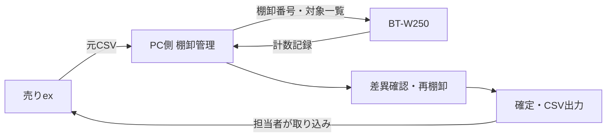

# 出荷資材 棚卸補助システム 基本設計書

作成日: 2026-10-31（日本時間）
状態: 推奨構成は採用済み。以下の詳細仕様は実装の基準案とし、確認待ち事項は第11節に記載する。

## 1. 目的と確定事項

出荷資材をバーコードで識別し、現場のハンディターミナルで実数を入力する。売りexから出力したCSVを基準に棚卸を行い、確定結果を売りexへCSVで取り込む。

- 基幹システム: シンプレスト社 exシリーズ「売りex」（名称はユーザー申告）。在庫の正本は売りexとする。
- 対象端末: 現場にあるキーエンス BT-W250。端末のOS、SDK、通信・配布方法は未確認。
- 資材の商品番号は既存。バーコード読取値と商品番号が一致するかは未確認。
- 元CSVには商品番号、名称、システム上の数量を含められる。実際の列定義は後日確認する。
- 売りexへのCSVインポートが可能。数量が実数か増減数か、更新単位やエラー時の挙動は未確認。
- ERPNext、Odoo、InvenTreeの棚卸設計を参考に、小規模な専用アプリを構築する方針を採用した。

## 2. 参考とする既存システム

2026-10-31に公開コードを参照した。下記リンクは可変ブランチであり、特定コミットに固定した依存関係ではない。コードの転用や組み込みはまだ行っていない。

| システム・参照先 | 確認した実装 | 採用する考え方 |
| --- | --- | --- |
| [ERPNext Stock Reconciliation](https://github.com/frappe/erpnext/blob/develop/erpnext/stock/doctype/stock_reconciliation/stock_reconciliation.py) | 商品・倉庫単位の数量検証と在庫調整 | 棚卸作業を単位として管理し、検証後に確定する |
| [Odoo stock.quant](https://github.com/odoo/odoo/blob/18.0/addons/stock/models/stock_quant.py) | inventory_quantity、inventory_diff_quantity、在庫への適用処理 | 基準数量・実数・差異を分離し、入力と反映を分ける |
| [InvenTree StockItem](https://github.com/inventree/InvenTree/blob/master/src/backend/InvenTree/stock/models.py) | stocktake()、棚卸日、作業者、結果数量の履歴 | 作業者・日時・変更履歴を保持する |

これらのERPや在庫管理を丸ごと導入せず、売りexとの二重管理を避ける。端末転送、CSV変換、再送防止などは今回の連携に必要な追加設計であり、上記製品がBT-W250に対応することを意味しない。コードを流用する際は、対象コミットとライセンス・配布条件を記録する。

## 3. 対象範囲と構成

初期版の対象は、元CSVの検証・取り込み、端末への対象配布、実数入力、結果回収、差異・未棚卸確認、確定CSV出力、連携履歴である。発注、原価計算、売上、常時の入出庫管理は売りex側で扱う。

PC側は棚卸業務ロジック・永続化・CSV変換を担当する。端末側は読取、商品確認、数量入力、保存、転送状態表示を担当する。CSVアダプターと端末転送アダプターを業務ロジックから分離する。

通信断でも入力を失わない端末内保存と一括転送を目標とする。実現方法はBT-W250の対応機能を確認して選定する。Web/PWA、Androidアプリ、特定SDKの利用を現段階では前提にしない。PC側の言語・DB・配布形態も実行環境確認後に確定する。

## 4. 業務フローと状態

1. 担当者が対象範囲と基準日時を決め、売りexからCSVを出力する。
2. PC側で形式・重複・数量を検証し、元ファイルを保管する。検証成功後に棚卸番号を発行し、基準数量を固定する。
3. 対象一覧を端末へ配布する。端末には棚卸番号と対象データの版を付ける。
4. 現場でバーコードを読み、商品名・単位を確認して実数を入力する。
5. PC側に記録を回収し、未棚卸・差異・競合を確認する。必要に応じて再棚卸する。
6. 確認者が対象範囲の完了を確認し、結果を確定する。
7. 売りex形式のCSVを出力し、担当者が売りexへ取り込む。
8. 売りex側の結果を確認し、連携済みを記録する。

状態は「準備中 → 棚卸中 → 確認中 → 確定 → 出力済み → 連携確認済み」とする。確認中から棚卸中へ戻して再計数できる。確定後の記録は直接上書きせず、訂正版を作成して再確認する。出力済みは連携成功を意味しない。出力済みの訂正は、旧ファイルの取り込み状況を確認するまで再出力を止める。

初期運用は対象資材の入出庫を停止する時間帯での棚卸を推奨する。CSV出力から実数確定までに移動があれば、基準と実数の時点が一致しない。停止できない場合は移動実績の取得と補正設計が必要で、単純な差異計算だけでは対応しない。

## 5. 画面と端末操作

### PC側

- 棚卸一覧: 棚卸番号、対象範囲、基準日時、進捗、状態。
- CSV取り込み: 列対応、文字コード、プレビュー、行別エラー。エラーがある場合は取り込みを確定しない。
- 結果確認: 商品番号、名称、単位、基準数量、実数、差異、未棚卸、競合、最終作業者。
- 履歴: 元CSV、計数・訂正、端末受信、確定、出力、連携確認。

### ハンディ側

「棚卸選択 → 担当者・作業場所選択 → 読取 → 商品確認 → 数量入力 → 保存 → 次の読取」を基本とする。物理キーでの数量入力・確定を優先し、実機でキー割当と表示量を決める。

- 保存成功が確認できてから次の読取へ進む。保存失敗時は入力値を残す。
- 同じ場所・同じ商品の再読取は既存数量を表示し、訂正として扱う。自動加算しない。
- 別の場所の数量は明示的に場所を変えて追加し、商品別に合算する。
- 未登録バーコードは未解決記録に残し、既存商品へ勝手に割り当てない。
- 数量ゼロは明示入力する。未入力は未棚卸として保持する。
- 初期版は実数入力方式とし、1スキャンごとに1個加算する方式や箱数換算は対象外とする。

## 6. 論理データ設計

| エンティティ | 主な項目・制約 |
| --- | --- |
| 棚卸作業 | 棚卸ID、対象範囲、基準日時、状態、元ファイルID、データ版、作成者 |
| 元ファイル | 元ファイル名、保存先、ハッシュ、取り込み日時、適用したCSV定義 |
| 棚卸対象 | 棚卸ID、商品番号、名称、基準数量、単位、売りexの在庫管理区分（確認後に定義） |
| バーコード対応 | 読取文字列、商品番号、有効状態。複数候補に一致する対応はエラー |
| 作業区画 | 棚卸ID、場所ID、対象範囲、担当者、完了状態 |
| 計数記録 | 記録ID、棚卸ID、対象ID、場所ID、数量、端末ID、担当者、端末記録日時、受信日時、訂正元ID |
| 確定結果 | 棚卸ID、結果版、対象ID、合計実数、差異、確認者、確定日時 |
| 転送・出力履歴 | バッチID、ファイルハッシュ、処理結果、件数、エラー、出力版、連携確認者・日時 |

商品番号・バーコードは先頭ゼロを保持する文字列とする。数量は十進数で保持し、入力可能な小数桁・単位・上限は実データ確認後に設定する。負の実数は拒否する。基準数量が負の場合の取り扱いは売りexの仕様に合わせ、黙ってゼロに直さない。

商品番号だけで一意になるとは決めつけない。倉庫・ロットなど売りexの更新単位を確認し、必要な区分を対象キーに含める。内部の作業場所と売りexの倉庫区分は分ける。

## 7. 集計・重複・訂正の規則

- 基準数量は元CSVのスナップショットとして不変にする。途中の再取り込みは別の棚卸作業とする。
- 差異 = 確定実数 − 基準数量。未棚卸の差異は未確定とし、ゼロとして計算しない。
- 訂正は元記録を残し、新しい記録で置き換える。集計には採用された最新版だけを使う。
- 複数場所の数量は合算する。場所未使用の運用でも内部には既定の作業区画を設ける。
- 商品が一度読まれたことだけで棚卸完了とはしない。対象区画の確認完了を含めて判断する。
- 同じ区画を複数端末が計数した場合は自動合算・後勝ち上書きをせず、競合として確認者が解決する。
- 端末IDと記録IDで再送を検知する。同一ID・同一内容は受領済みとして返し、同一ID・異なる内容はエラーにする。
- 受領済みの確認前に端末記録を削除しない。再起動後も未送信記録を再送できるようにする。
- 受信バッチは全件検証後に一括反映する。途中エラーで一部だけ反映しない。

## 8. CSV連携

元CSV形式、端末交換形式、売りex取り込み形式を別々に定義する。売りex用の列順や文字コードを内部データ構造へ直接持ち込まない。

CSV定義には列名・列順・文字コード・区切り・引用符・改行・ヘッダー有無・商品番号形式・数量単位を含める。UTF-8やCP932を候補とするが、実物確認前に固定しない。文字化けや不正な数量はエラーとし、欠落や置換を伴う取り込みを許さない。

CSV出力は確定版から作成し、出力ファイルとハッシュ・件数・版を保存する。同一版の再ダウンロードは同じ成果物を返す。未棚卸をゼロで出力しない。部分棚卸の出力や差異ゼロ行の省略は、売りexの更新仕様が分かるまで有効にしない。

売りexが実数更新を要求する場合は確定実数、増減更新を要求する場合は承認された差異を出力する。特に増減CSVの二重取り込みは二重更新になるため、再取り込みの前に売りex側の結果確認を必須とする。本システムの重複検知だけでは、売りex側での二重操作を防げない。

## 9. 保存・権限・復旧

計数担当者と確定・出力担当者の操作権限を分ける。各操作を担当者に紐付け、端末の紛失・故障に備えて回収済みデータをPC側で保管する。元CSV、記録、確定結果、出力物をバックアップ対象とし、保存期間と保存場所は運用時に決める。実データをGitリポジトリへ登録しない。

## 10. 実装順序と受入確認

1. 仮データで棚卸作業、計数履歴、集計、確定、CSVアダプター境界を実装する。
2. CSVサンプルで入出力形式と売りexの更新単位を確定する。
3. BT-W250でバーコード取得、キー操作、永続保存、再起動復旧、PC転送を小規模に実証する。
4. 実証済み方式で端末画面と転送を実装する。
5. 売りexの検証可能な環境で往復連携を確認し、現場で試験する。

最低限の受入条件:

| ケース | 期待結果 |
| --- | --- |
| 先頭ゼロ付き商品番号 | 読取・CSV往復で元の番号を保持する |
| 未棚卸と実数ゼロ | 別状態になり、未棚卸をゼロ出力しない |
| 基準10、実数8 | 差異が-2になる |
| 同じ場所を8から7へ訂正 | 合計は7、訂正履歴は保持される |
| 別の場所に3と5 | 合計は8になる |
| 同じ記録を再送 | 数量と記録件数が増えない |
| 複数端末が同じ区画を計数 | 競合となり、未解決のまま確定できない |
| 未登録・曖昧なバーコード | 商品へ自動割当されず確認対象になる |
| 保存中断・端末再起動 | 保存済み記録が残り、未送信記録を回収できる |
| CSVに不正行が混在 | 行別エラーとなり、一部だけ取り込まれない |
| 出力後の売りex取り込み失敗 | 連携確認済みにならない |
| 売りexとの往復連携 | 商品番号・単位・数量が想定どおり反映される |

## 11. 確認待ち事項

- 売りexの入出力CSVサンプル、必須列、文字コード、在庫更新単位、実数/増減の意味、部分失敗時の挙動。
- BT-W250のOS・ファームウェア、利用可能なSDK/開発ライセンス、既存アプリ、配布と転送方法。
- バーコード規格と読取値の例、商品番号との対応、箱と個の単位関係。
- 対象商品数、端末台数、同時作業者数、保管場所・倉庫・ロット管理の有無。
- 棚卸中の入出庫停止可否、再棚卸の判断基準、確認者と担当者の割当。
- PCのOS、利用人数、設置場所、ネットワーク、バックアップ運用。

CSVサンプルと実機条件が揃うまでは、売りexへの本番取り込みやBT-W250での動作を保証する設計ではない。基本モデルと仮データでの検証を先行させ、確認結果を本書へ反映する。
