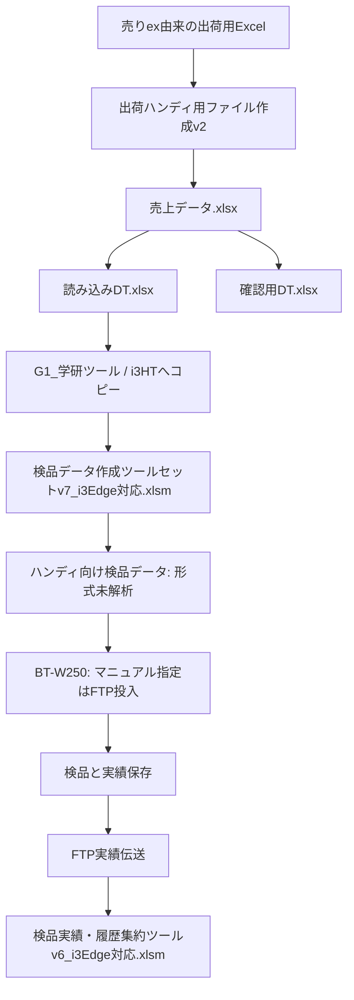

# 現場Excel・作業マニュアルの静的解析

解析日: 2026-11-01（日本時間）。添付文書は参考資料として読み、記載された操作を実行指示とは扱っていない。マクロ実行、FTP/USB通信、現場共有先へのアクセス、元ブックの変更は行っていない。

## 根拠

| ファイル | SHA-256 | 確認方法 |
| --- | --- | --- |
| 出荷ハンディ用ファイル作成v2.xlsm | 78d0d3940e85a94cd2dd43ac3e683032d1c385cdf39176080cb426489f9fc717 | openpyxlによるセル読取、oletoolsによるVBA抽出・静的読解 |
| マニュアル 　スキャン用.xlsx | d7d9fadeca761faa7be1f60cc7c5f1e7e07f6cac7c2f1cb224351c1db911930c | セル読取と埋め込み図の視認 |

元ファイル・抽出VBA・画像はGitに登録しない。認証情報、顧客データ、共有先の絶対パスを解析結果へ転載しない。資料内の手順・認証情報を、本システムの設定として取り込まない。

## 1. データの経路

GとLの実ファイルは今回の添付には含まれない。Gの生成形式、開始キー、Lの実績列・数量の意味は、この2ファイルだけでは確定できない。現場写真のツール名と元ブックの参照を照合した候補であり、集約ツールv6の内部参照は未確認。

## 2. 共有されたVBAで確認できた処理

| 処理 | 根拠（抽出Module3） | 確認内容 |
| --- | --- | --- |
| 元ファイル形式確認 | ExecPList_ChgData / ExecPList_ChkData / strItemCkTitle | 出荷伝票の多数の列を照合・並べ替え。商品コード・名称・在庫数量の3列だけの入力ではない |
| 中間処理 | ExecPList_DataCopy | コピーのシートを伝票データへ変更し、不要列・不要行を除く。売上/移動の処理区分、送付先区分、運送便による除外がある |
| ハンディ読み込み前のExcel作成 | ExecHtFile_FileCreate | 中間Excelを読み込みDT.xlsxと確認用DT.xlsxへコピー。確認用では追加の列を削除 |
| 前回ファイル削除 | ExecHtFile_Output_Click / ExecHtFile_FileDelete | 元の中間ファイルが存在すれば前回生成した読み込み用・確認用を削除して作成 |
| 学研ツールとの接続 | ExecHtFile_GknTool_Click | 設定されたi3HT配下の同名ファイルを削除して読み込みExcelをコピーし、別のv7ブックを開く |

設定セル: HTファイル作成!B7/B10が読み込み用フォルダー/ファイル、B17/B20が確認用、B30が学研側取り込みフォルダー、B33がv7ブックの相対パス。現場ファイルや設定値の変更は行っていない。

VBAのヘッダー宣言と第1段階削除リストからの静的計算では、学研ツールへ渡す中間Excelには34列が残る想定。伝票番号・商品CD・商品名・数量などが含まれる。実データの生成実行で検証したものではなく、ハンディ自身が直接読むCSVの列数でもない。

## 3. マニュアルで判明した運用

- スキャン前PC作業: 処理データ作成 → HTファイル作成 → 学研ツール起動とファイルコピー → 学研ツールの検品データ出力。
- スキャナ側作業: 検品データ投入(FTP)、作業後は実績伝送(FTP)を指定。
- 同シートB10/K10では、USBを選ぶとエラー・停止する旨を明示している。USBメニューの存在を使用可能の根拠にしない。現場設定の変更なしにUSB切り替えを勧めない。
- マニュアルにはデータ上書き操作があるが、これは既存出荷業務の手順。今回の棚卸試験で出荷データを上書きしてよいという許可ではない。
- スキャン後PC作業(新): G1_学研ツール配下の検品実績・履歴集約ツールを開いて集約する。
- 埋め込みの旧図にはUSBメモリとWebDAVの説明もある。現場手順本文のFTP表記および現在のハンディ画面と異なるため、通信の詳細は現行v7設定で確認する。
- 旧実績集約画面にはi3HT/RES配下とbkへの保存の説明がある。現行v6で同じ構造かは未確認。

## 4. 棚卸V1に関する判断

出荷伝票の既存マクロを、資材の棚卸3列CSVにそのまま実行する方式は採らない。出荷用の行除外や列要件があり、棚卸対象の欠落につながる。棚卸から学研ツール入力へ変換する場合も、v7の設定と実績形式を調べた後、出荷用フォルダーから分離した検証用の保存先で実装する。

既存アプリが予定数との検品に特化し、任意実数・差異・ゼロ・未棚卸を記録できなければ再利用は不適合。予定数量へ一致するまでスキャンさせる方式や、基準在庫を実数として転記する方式で棚卸要件を代替しない。数量入力・訂正と回収実数の意味は引き続き未確認。

## 5. 次に必要な資料

優先1: 検品データ作成ツールセットv7_i3Edge対応.xlsmのコピー。設定シート、商品マスタ、開始キー生成、CSV出力、FTP向け配置先を静的解析する。

優先2: 検品実績・履歴集約ツールv6_i3Edge対応.xlsmのコピー。実績取得元、列定義、数量、訂正と重複処理を静的解析する。

可能なら、i3HTのファイル一覧と、個人・取引情報を置換した投入/実績データの例も確認する。まず原本を変更しない静的調査を行い、開始キーや列定義が分かる前に任意ファイルを現場へ投入しない。資格情報をチャットへ書く必要はない。

## 現在の結果

既存の出荷ワークフローと別ツールへの依存関係は特定できた。ハンディ投入CSVそのものと開始キー・実績数量はまだ特定できていない。解析結果はA03/A05の合格証拠ではなく、既存アプリ利用可否を判断するための根拠。

## 続報

v7/v6本体を追加受領して[詳細解析](gakken-v7-v6-analysis.md)を行った。本書の「未入手」は初回解析時点の記録。現在は開始キー＝伝票番号、18列/4列のTSVとi3Edge共有経路を確認。実績の数量意味と棚卸適合は引き続き未確定。
